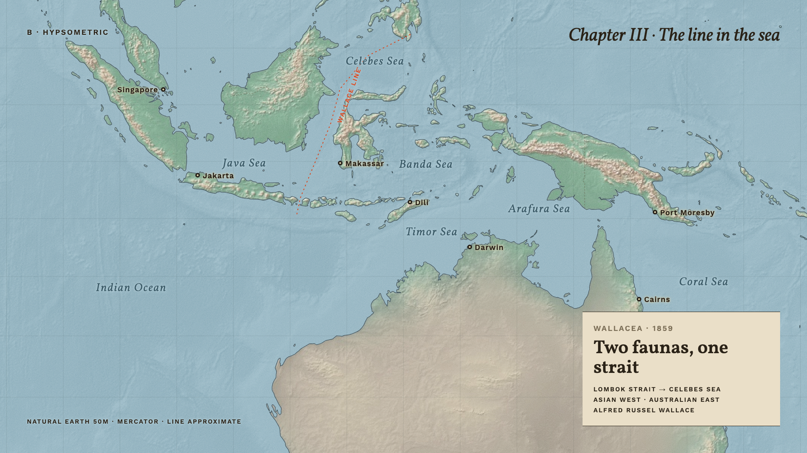

# Design decisions

Reference renders for the chosen look. Each entry names the decision, the date, and where it lives in code.

## Maps: hypsometric atlas (2026-11-09)

- Land coloured by the Natural Earth hypsometric raster (green lowlands to brown highlands), soft blue sea
  with faint ocean-floor shading, dark coastline, dashed borders, 5° graticule.
- Italic serif for water bodies, bold label face for cities, accent colour reserved for the one line that matters.
- Code: palette in `src/theme/themes/map.ts`, renderer prototype in `src/dev/mapspike2/RegionMap.tsx`,
  rasters in `public/textures/`. Rejected candidates are in `spikes/mapspike2/`.
- Status: chosen "for now" as the atlas style. Page theme (fieldguide family) is still being decided.
